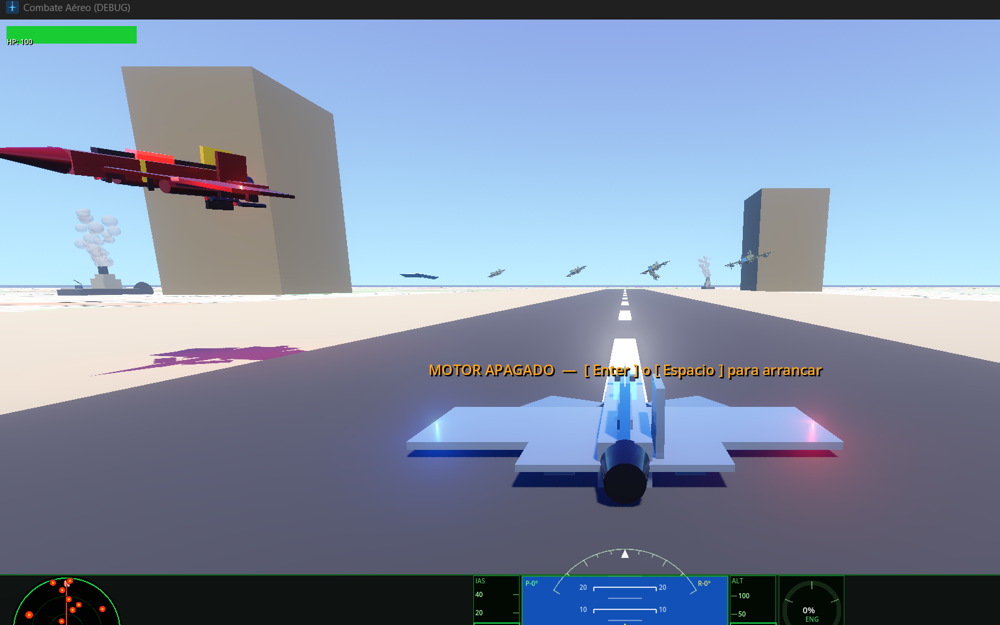
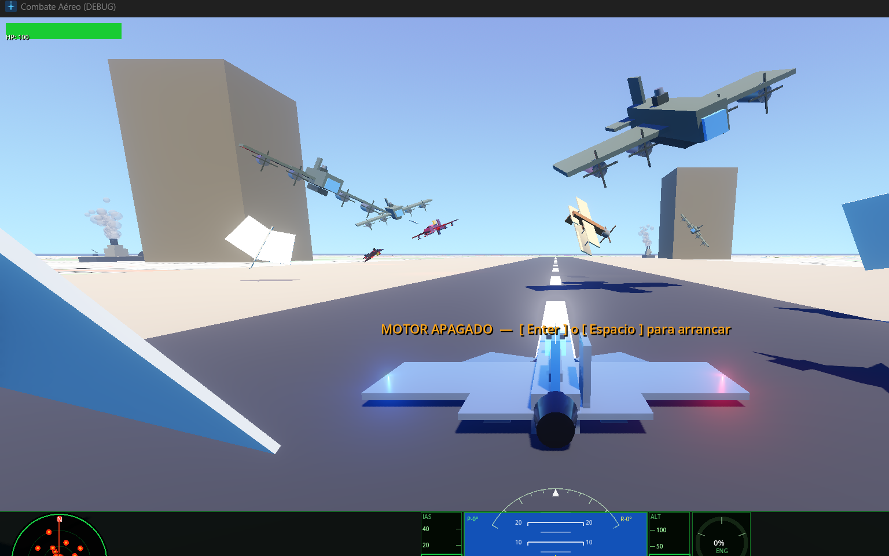
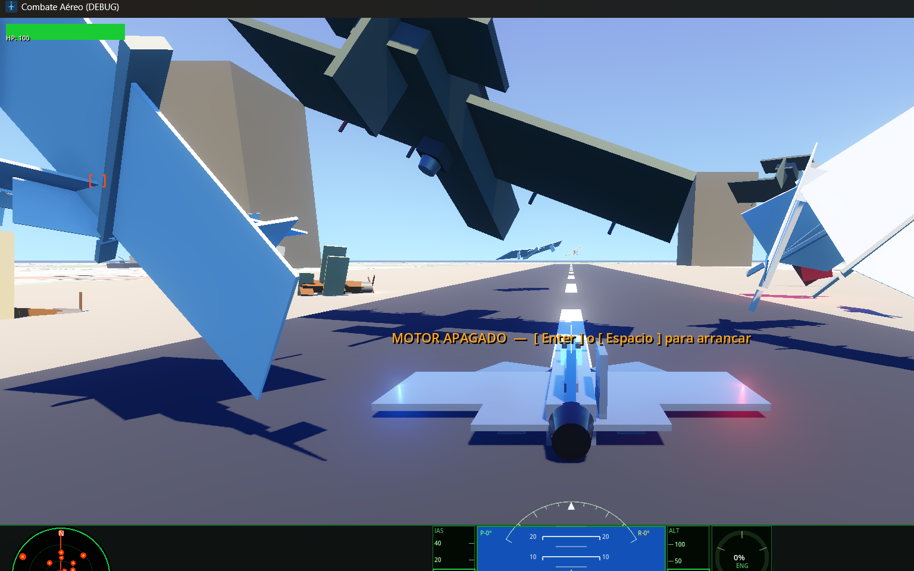

# ✈ Combate Aéreo v1

Juego de acción aérea en 3D construido íntegramente en **Godot 4** con **GDScript**. Toda la geometría se genera en código — sin modelos externos ni assets de arte — usando primitivas combinadas para construir aviones, barcos y objetivos detallados en tiempo de ejecución.

## Sobre el proyecto

Este proyecto nació como un experimento para darle uso a un joystick que tenía guardado y, sobre todo, por curiosidad: descubrir hasta dónde se puede llegar con las herramientas de un motor como Godot, divirtiéndome un rato mientras practicaba otro lenguaje y exploraba las capacidades de la generación de geometría procedural. No es un proyecto comercial ni busca serlo — es un banco de pruebas personal que terminó siendo un juego completo.

---

## Capturas de pantalla

### Pista de despegue con enemigos

> Vista desde la pista. Enemigos de varios tipos aproximándose: jets rojos, biplanos y barco al fondo.

### Tipos de enemigos en vuelo

> Bombardero (verde, gran envergadura), biplano (marrón, dos alas) y jets rojos atacando simultáneamente.

### Aviones de papel

> Los aviones de papel vuelan de forma muy errática y caen con un solo disparo.

---

## Cómo se juega

1. **Arrancar el motor** — presiona `Enter` o `Espacio` al inicio
2. **Despegar** — aumenta gases con `W` hasta superar la velocidad de despegue (~65 km/h)
3. **Volar** — usa las flechas para rotar el avión, `Q/E` para guiñada
4. **Disparar** — `Espacio` activa el cañón automático
5. **Misiles** — mantén un enemigo en pantalla para hacer lock-on, luego `M` para lanzar
6. **Sobrevivir** — el barco dispara de vuelta, los bombarderos sueltan ráfagas de 3 balas
7. **Puntuación** — destruye el mayor número de objetivos antes de ser derribado

---

## Características

- **4 tipos de enemigos** con IA independiente: jet rojo, avión de papel, biplano y bombardero
- **Objetivos destruibles**: globos aerostáticos, dirigibles y barcos de guerra con cañón AA
- **HUD tipo EFIS** con horizonte artificial, cintas de velocidad/altitud, brújula y radar
- **Sistema de armas**: cañón automático y misiles guiados con lock-on
- **Mapa de terreno real** vía tiles OpenStreetMap en tiempo real
- **Soporte para teclado y joystick** (AV8R-01 y compatibles)
- **Contador de destruidos** y sistema de puntuación

---

## Controles

| Tecla | Acción |
|-------|--------|
| `Enter` / `Espacio` | Arrancar motor |
| `↑ ↓` | Cabeceo (pitch) |
| `← →` | Alabeo (roll) |
| `Q / E` | Guiñada (yaw) |
| `W` / `RePág` | Aumentar gases |
| `S` / `AvPág` | Reducir gases |
| `F` | Boost de gases |
| `Espacio` | Disparar cañón |
| `M` | Lanzar misil |
| `P` | Silenciar / activar audio |

---

## Enemigos y objetivos

| Tipo | Vida | Puntos | Notas |
|------|------|--------|-------|
| Jet rojo | 30 | 200 | Dispara, IA con wobble |
| Avión de papel | 1 | 50 | Muy errático, no dispara |
| Biplano | 20 | 150 | Ágil, dispara |
| Bombardero | 60 | 400 | 3 balas en abanico, lento |
| Globo aerostático | 1 | 100 | Deriva lenta, colores aleatorios |
| Dirigible | 5 | 600 | Se ilumina al recibir daño |
| Barco de guerra | 10 | 1000 | Dispara cañón AA al jugador |

---

## Requisitos

- [Godot 4](https://godotengine.org/download/)
- Windows / Linux / macOS

## Cómo ejecutar

```bash
git clone https://github.com/ingenieroluisordonez-lab/airplanegame.git
cd airplanegame
godot --path .
```

O abre `project.godot` directamente con el editor de Godot.

---

## Stack

**Godot 4 · GDScript · Sin dependencias externas**

Geometría 100% procedural con `BoxMesh`, `SphereMesh` y `CylinderMesh`. Audio cargado desde archivos `.ogg`. Mapa OSM via HTTP requests a tile servers públicos.
